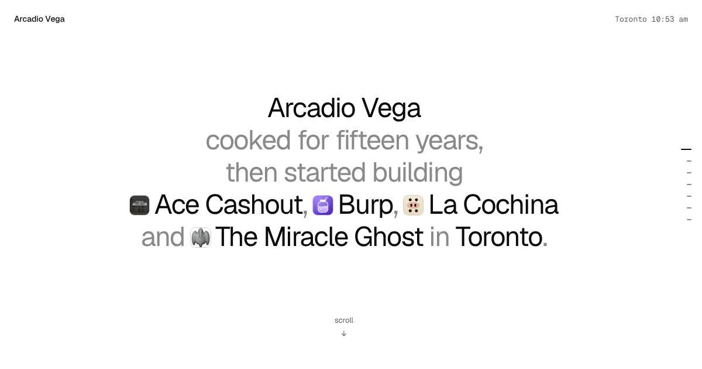
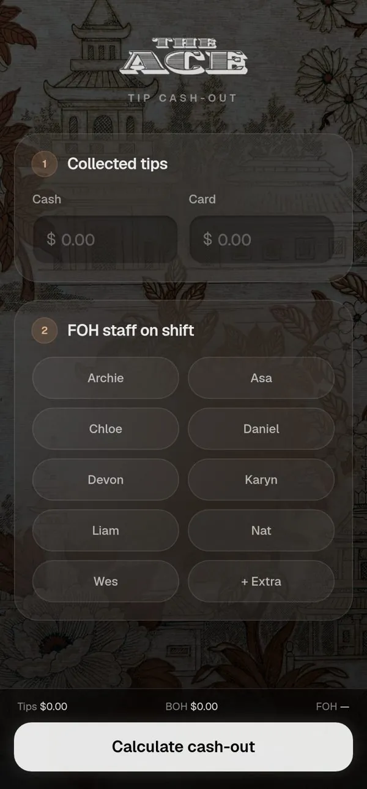
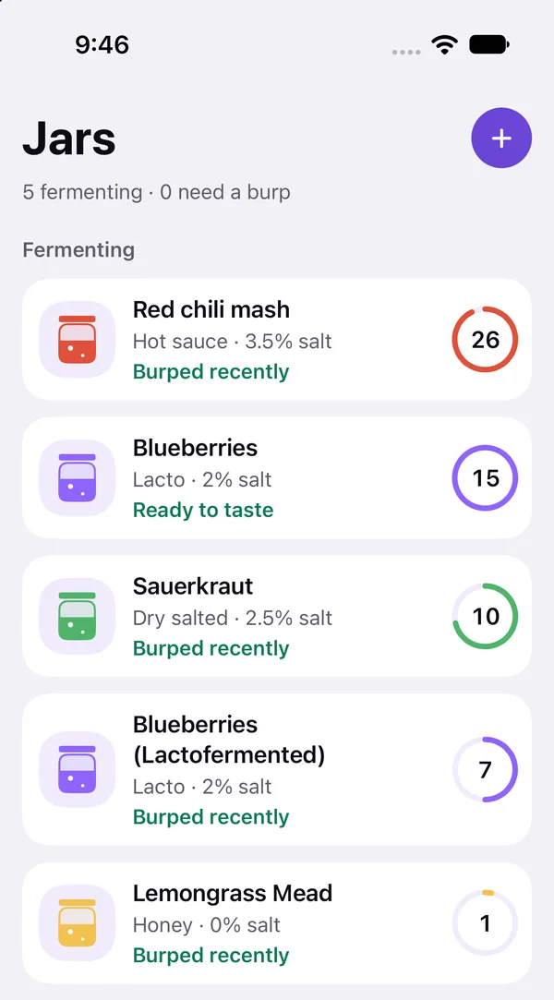
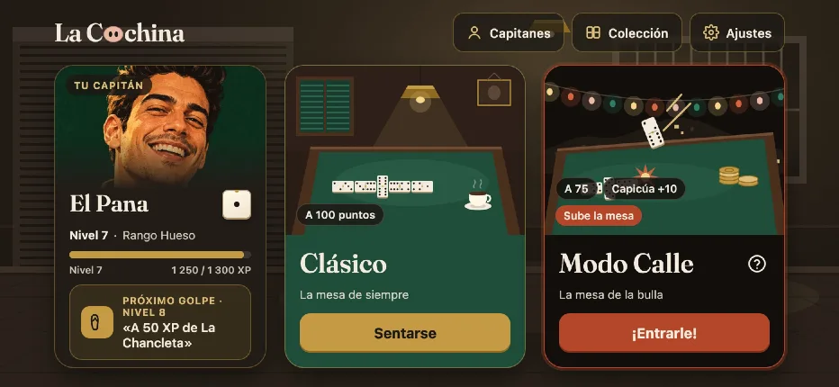
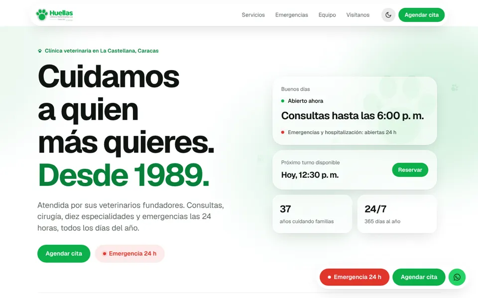

I cooked in professional kitchens for fifteen years. Now I build software that solves the problems I used to have on the line: splitting tips at close, scaling recipes, finding a cocktail spec in the middle of service. I work across the stack with **Next.js, React and TypeScript**, and I build native iPhone apps in **SwiftUI**.

I'm looking for my first **junior developer role** in Toronto, in web, full-stack or iOS.

**[arcadiovega.com](https://arcadiovega.com)** · [LinkedIn](https://www.linkedin.com/in/arcadio-vega) · arcadiovega1@gmail.com

---

## Ace Cashout · in production since March 2025

Tips used to get split by hand at close, on a phone calculator. Now the closing shift enters the tips, taps who worked, and gets an exact split, even offline. The owner gets a payday view, a Thursday email with who to pay, and pay stubs for every staff member. It's been used at The Ace for **about 700 services**.

Some decisions I'm proud of:

- **Money in whole cents.** Largest-remainder rounding means payouts plus the kitchen's share always equal the tips. Unit tests pin it down.
- **Paid weeks are locked.** A save takes a database lock on its week, so nothing can change money that already went out.
- **Emails are claimed once.** A retried cron job never sends a duplicate pay stub.
- **Offline without a sync engine.** A service worker caches the app and unsent saves wait on the device.

`Next.js` `React` `TypeScript` `Tailwind` `Postgres` `Vercel Cron` `Resend` `CI tests`

**[Code](https://github.com/cholohotsauce/cashout-calculator)** · **[Live](https://acecashout.com)** · **[Case study](https://github.com/cholohotsauce/cashout-calculator/blob/main/docs/CASE_STUDY.md)**

 

---

## The Miracle Ghost · client work

A website and shop for AES, a Miami street artist and one of the graffiti artists featured in GTA VI. It has an interactive 3D ghost with tricks and moods, a wall you can paint, and Shopify checkout.

`Next.js` `TypeScript` `three.js / react-three-fiber` `Framer Motion` `Shopify`

**[Live](https://themiracleghost.com)** · code is private for the client, happy to walk through it

 

---

## Burp · iPhone app, in progress

A fermentation tracker for the jars in my kitchen. It reminds me which jar needs a burp, works out the salt for a brine, and keeps tasting notes and photos. Widgets, Live Activities and Siri Shortcuts can burp a jar too.

- Status is worked out from dates, so nothing stored can go stale.
- The core calculations take the clock as an input, so edge cases are easy to test.
- Private by design: no accounts, analytics or third-party packages.

`Swift 6` `SwiftUI` `SwiftData` `WidgetKit` `ActivityKit` `App Intents` `Swift Testing`

**[Build notes on arcadiovega.com](https://arcadiovega.com)**

 

---

## La Cochina · iPhone game, in progress

Venezuelan dominoes, played the Caracas way: four players in two teams, the double-six opens, and the first team to 100 wins.

- The rules engine is a pure Swift package with no UI imports, so a server could reuse it for online play.
- Deals are seeded, so any game can be replayed and tested.
- Bots only get legal moves and never see hidden hands.

`Swift` `SwiftUI` `Swift Package` `swift test`

**[Build notes on arcadiovega.com](https://arcadiovega.com)**

---

## Client sites

Websites I built for a restaurant (The Ace, Toronto), a vet clinic (Huellas, Caracas), a veterinary cardiologist and a writer. `Next.js` `HTML` `JavaScript`

---

## Also on GitHub

| Project | What it is | Stack |
|---|---|---|
| [ace-bartender-app](https://github.com/cholohotsauce/ace-bartender-app) | Cocktail spec app for The Ace bar staff, with search, favorites and swipe gestures | TypeScript, Vite |
| [gelato-calculator](https://github.com/cholohotsauce/gelato-calculator) | Scales gelato base recipes to any batch size and exports a PDF batch sheet | React, Vite, jsPDF |
| [geowho](https://github.com/cholohotsauce/geowho) | "Guess Who" with world capitals, my capstone at George Brown College | React, TypeScript, Zustand |
| [portfolio](https://github.com/cholohotsauce/portfolio) | The code behind arcadiovega.com | HTML, CSS, JavaScript |

## Tools

`TypeScript` `JavaScript` `React` `Next.js` `Tailwind CSS` `Node` `Postgres` `Swift` `SwiftUI` `SwiftData` `Python` `Git` `Vercel` `GitHub Actions`
